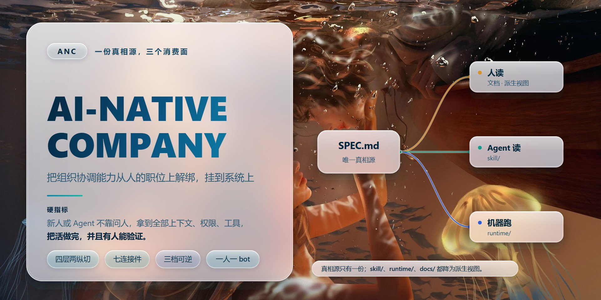
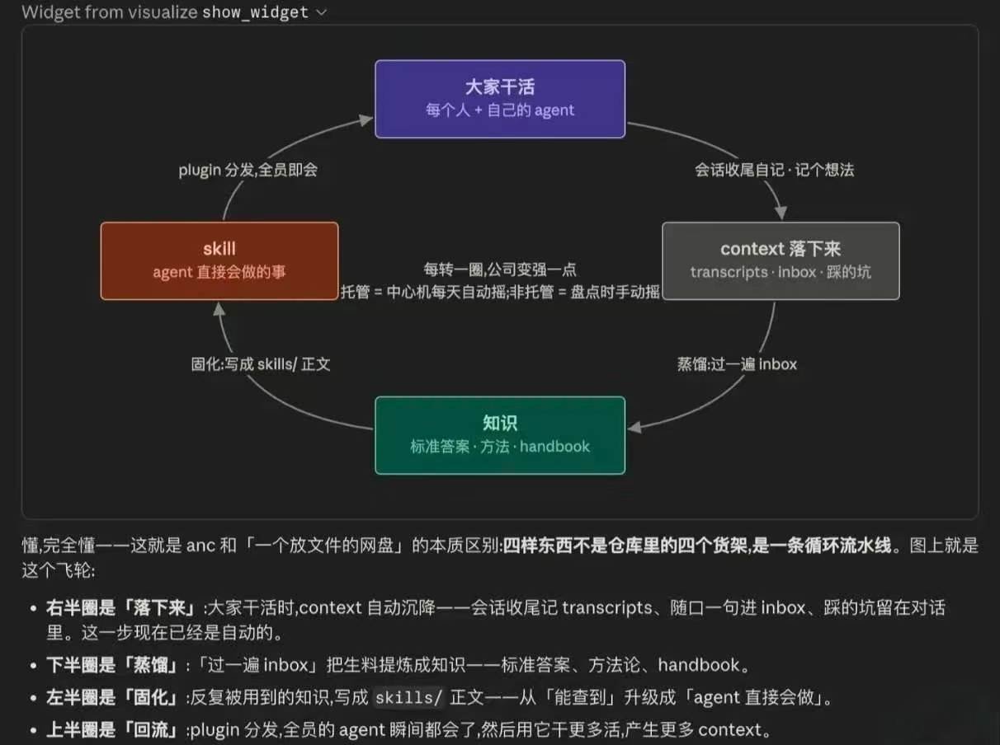

# ai-native-company



> **两条核心：一条飞轮（干活 → 落下来 → 蒸馏 → 固化 → 回到干活），一套调派（派给谁、凭什么、接到哪、谁验）。**
> 飞轮让公司变强一点，调派让活真的落地 —— 一进一出。

一家公司里最贵的东西不是算力，是「这件事该找谁、凭什么、做到哪了」。
这些信息今天装在人的脑子里、聊天记录里、和被反复转述的口头约定里。
人一走、一休假、一忘，它就得重新问一遍 —— 而这笔成本从来没人记账。

ANC 把这件事搬进系统：**组织的事实写成文件，权限写成数据，动作留下痕迹。**
于是新人不必问人、Agent 不必猜、老板不必挨个问进度。

---

## 核心：这不是四个货架，是一条循环流水线



大多数"知识管理"产品把四样东西做成四个仓库：文档库、聊天记录、知识库、插件市场。
**ANC 的差别是：它们是一条首尾相接的流水线，上一圈的产出就是下一圈的原料。**

| 圈 | 这一步在做什么 | 今天 |
|---|---|---|
| **右 · 落下来** | 大家干活时 context 自动沉降：会话收尾记 transcripts、随口一句进 inbox、踩的坑留在对话里 | ✅ 归集已有（`anc audit collect` / trail）；inbox 有目录与规矩，投递仍靠人或 agent |
| **下 · 蒸馏** | 过一遍 inbox，把生料提炼成知识：标准答案、方法论、handbook | ⚠️ `anc distill` **只读、现算、不写 skills/**；经验对象已有 approve/deploy，但 deploy 只改状态与台账 |
| **左 · 固化** | 反复被用到的知识，写成 `skills/<name>/SKILL.md` —— 从「能查到」升级成「agent 直接会做」 | ⚠️ 落点已定（`ctxpack` 会报 missing），**从经验写进 skills 的通道还没接** |
| **上 · 回流** | 让全员的 agent 知道"有这个新技能"，**自己查、问人、人点头才用** | ⚠️ 拉取式已落（`anc skill check`；按人记"看过哪一版"）；**故意不做推送**——推送等于替 agent 改行为。缺效果度量 |

**两种转法**：托管 = 中心机每天自动摇；非托管 = 盘点时手动摇。
我们只有定时器（`anc job`）和只读的蒸馏，**"每天自动摇"那条链还没接**。

一句话判据：**任何新功能，如果它不增加这一圈的转速、也不减少某一环的摩擦，它就不该做。**

## 另一个核心：组织调派

飞轮解决「公司怎么变强」，调派解决「活怎么落地」——
**谁该接、凭什么接、接到哪一步、卡住找谁、交出去之后谁验。**

它不是一个派单看板，是一条带**协议阶段**的闭环：

| 步 | 动作 | 命令 | 保证 |
|---|---|---|---|
| 立项 | 谁要什么、验收标准是什么 | `anc task add` | 没有验收标准不许立项 |
| 派 | 派给谁、凭什么 | `anc task route` / `anc task pull` | 派给岗位不派给人名；跨域要授权 |
| 认领 | 谁真的接了 | `anc task ack` | 认领有租约，**不认领会过期被别人领走** |
| 推不动 | 卡在哪、等谁 | `anc task escalate` | 升级留痕，不靠喊 |
| 交接 | 换手给谁 | `anc task handoff` | 交接是显式动作，不是"他应该知道了" |
| 收口 | 交、验、结 | `anc task submit` / `verify` / `settle` | 验收只能三态：还没判 / 接受 / 驳回；结账落库 |

六个协议阶段（`queued → running → review → blocked → done / cancelled`）回答"流程走到哪"，
业务状态另存一个词 —— **换个业务词不会让机制失灵**。

**今天到哪一步**：

- ✅ 状态机、十个子命令、热层队列、审批回路、跨域判定都在跑
- ⚠️ **卡点（blocker）与突破（breakthrough）还不是独立对象** —— 现在只是一个 stage 与一句话，
  所以"这个坑踩了几次"答不出来（SPEC §14.2）
- ⚠️ 派活靠人指定 + 路由表，**没有"该谁接"的自动分派**；也没有按最坏损失排序
- ❌ 没有"调派台账"：谁派给谁、换了几个手、每个手停多久，现在要从流水里现算

**与飞轮的关系**：每一次派活、卡点、交接、驳回都是**生料**。
调派产生 context，飞轮把它变成知识 —— 两条核心不是并列的两个产品，是一进一出。

## 让飞轮转得动的四个部件

下面四个说法是**机制**，不是目的 —— 目的是上面那条流水线。每个都对应到代码与「今天做到哪一步」。

| 说法 | 具体指什么 | 落在哪 | 今天 |
|---|---|---|---|
| **神经中枢** | 组织的事实只有一份：谁负责什么、资料在哪、能碰什么。所有动作都从这份事实出发，改口径只改一处 | `SPEC.md` + 客户的 vault（纯文本，进 Git） | ✅ 已落 |
| **反射弧** | 越界在**门口**被拦下，不是事后追责；撤权即时生效；判不出来就说「无法判定」，**永不默认放行** | `internal/org.Exercise` + 信封关卡 | ⚠️ 判定点还有 5 处没收敛（SPEC §15.4） |
| **调度中心** | 谁把活派给谁、进行中的状态在哪、谁认领了、卡了多久；跨域派发要一张授权 | 热层队列 + `anc task` / `anc hot` / `anc approvals` | ✅ 队列与状态在跑 |
| **指挥部** | 今天有没有事要你拍板、第一条是什么、点哪儿处理；谁签过、凭什么、原文在哪一行 | 看板 + 待批 + 审计双流水 | ⚠️ 决策回路能走通；追溯只覆盖一部分页面 |

**一句老实话**：中枢与调度基本成立，指挥部完成了一半。
「每个数字都能点回原文」现在只做到部分页面；「新人不必问人」这条产品判据**还没成立**（见 [`PRODUCT-SPINE.md`](./runtime/docs/PRODUCT-SPINE.md)）。

这不是自谦 —— 一个指挥部如果自己在吹牛，它指挥不了任何人。

## 它解决的是什么

不是"帮你写代码"，也不是"帮你聊客服"。它解决的是三件反复发生的麻烦：

| 麻烦 | 今天的解法 | ANC 的解法 |
|---|---|---|
| 新人来了，一周都在问人 | 老同事带、文档找 | 真相源里就有"谁负责什么、资料在哪、能碰什么" |
| AI Agent 让它干活，它不知道边界 | 靠 prompt 约束 | 权限是数据，越界在门口就被拦下，被拦也留痕 |
| 出事了，查不出是谁批的 | 翻聊天记录 | 每一笔行使都有：谁、何时、依据哪条授权、原文在哪 |

判断这套东西成不成，只有一句话：

> **一个新人和一个 Agent，能不能不靠问人，拿到全部上下文、权限和工具，把活干完，并且有人能验证。**

完整口径在 [`SPEC.md`](./SPEC.md)。它的 §18 是**文档总索引**：每个设计主题对应哪份细则、落到哪段代码、现在成立不成立、怎么验。

---

## 它长什么样

三个面，同一份事实：

| 面 | 是什么 | 在哪 |
|---|---|---|
| **真相源**（读者：Agent） | 一家公司的组织事实：谁在做什么、数据在哪、谁能碰什么。全是文本文件，进 Git。 | `SPEC.md` + 客户自己的 vault |
| **接入面**（读者：Agent，**主入口**） | 一个单二进制 `anc`：初始化、装配、任务队列、审批、审计、作业、外部接入。 | `runtime/` + MCP |
| **观测面**（读者：人，**可选窗口**） | 一块只读看板 + 少量写动作。它只是把 agent 已经能读到的东西给人看一眼。 | `anc board serve` |

真相源只有一份，另外两个面都是它的派生视图 —— 改口径只改一处。

**主消费者是 Agent，不是人。** 前端做得再好，也只是"人能看"；
真正的核心能力是 **Agent 能不能拿到、拿到的和人是同一份事实**。
**中枢之所以是中枢，就因为它不存第二份记忆：接入面和观测面都不许自建事实。**

## 三条不许破的规矩

这三条决定了它跟"又一个 AI 工具"的区别。

**一、每个数字都要能回到原文。**
看板上的汇总数字，点开能看到它的公式、来源文件与行号、谁维护的、多久没更新。
算不出来的数字不上屏，宁可不画。

**二、权限是数据，不是代码里的 if。**
岗位能碰哪些模块、跨域能不能行使、这条授权有没有被撤回 —— 都在文件里，改文件就改权限。
判定在行使的那一刻做：撤了权就是不能用，过期就是过期，签发的人走了链就断。
判不出来的时候，结果是「无法判定」，**永远不是「放行」**。

**三、动客户的东西，按生产变更对待。**
预演只算不写 → 逐字段说清改了什么 → 写临时文件 → 读回来验一遍 → 备份旧版 → 原子换名。
任何一步失败，盘上什么都不变。停用不等于删除，历史留着。

## 谁在用它，用它做什么

- **一号位**：今天有没有事、该谁动手、有没有东西在烂。
- **业务负责人**：我的域里谁在跑什么、卡在哪、要不要我拍板。
- **一线**：接手一件事、办完、交给下一手，全程不用问"这该找谁"。
- **Agent**：被派活、拿上下文、在权限内动手、被拦时知道为什么。

## 怎么开始

```bash
cd runtime
bash dev/dev.sh all      # 宿主机不需要装 Go：fmt / vet / 测试 / 六目标交叉编译 / 烟测
bash dev/dev.sh board    # 起一个演示看板，地址打在终端上
```

从零建一份真相源：

```bash
anc init <目录> --client <客户名> --tier 1
anc org init <目录> --client <客户名> --id <ascii-id>
anc org check <目录>
```

## 结构

```
ai-native-company/
├─ SPEC.md          真相源：组织模型 · 四层两纵切 · 七连接件 · 三档可逆 · 判据
├─ assets/          封面与作者头像
├─ docs/            给实现读：上游四份实现视图的副本
├─ skill/           给 Agent 读：可单独安装的能力件
└─ runtime/         给机器跑：单二进制 + 只读看板
   ├─ DESIGN.md     运行层落地设计（决策在 §0，实测记录在 §7）
   ├─ docs/         计划、规格、决策台账、指标合同
   ├─ dev/          容器里的验证腿
   └─ testdata/     测试样本一处收着
```

**测试代码跟着包走，测试样本一处收着。** 前者是 Go 的语言约束，
后者是纪律：样本不进正式文件的目录，免得有人把它当数据读。

**开放问题不在仓库里。** 未定事项记在 [Issues](https://github.com/Jivan-sky/ai-native-company/issues)，
每条写清「要定什么 / 为什么没定 / 选项与建议 / 验收 / 卡住谁」。

## 它不做什么

- **不做第二套写口。** 装、审、接这些动作最终落回命令行语义，看板只在白名单上开几条写口。
- **不把客户的库搬过来。** 数据在客户库里，ANC 只连不搬；升级代码不碰那些库。
- **不假装有权限。** 没有真身份时，页面级可见性只是演示，能力判定默认关闭，页面上就写着这句话。
- **不承诺降本数字。** 提效是结果，不是卖点：先让"找谁、凭什么、做到哪"这件事有答案。
- **不替客户决定治理。** 谁有权发第一个权限、撤权什么时候生效，由客户定；我们只提供机制与默认值。

## 与 FDE 的关系

[`fde-48h-sprint`](https://github.com/Jivan-sky/fde-48h-sprint) 负责接需求、判真伪、打穿一个点、换授权和现场。
ANC 负责打穿之后：把那一刀接回树干，长期跑下去。两者是同一根链条的两段。

## 与上游的关系

`SPEC.md` 是合并稿：工程实现层以 [`HA7CH/ai-native-company`](https://github.com/HA7CH/ai-native-company)
（MIT，含生产环境落地经验）为骨架；组织模型、七连接件、可逆性三档与单一出口、判据，来自本仓库。

---

## 作者

<table>
<tr>
<td align="center" width="50%">
  <a href="https://github.com/Jivan-sky"></a><br>
  <b><a href="https://github.com/Jivan-sky">@Jivan-sky</a></b><br>
  <sub>产品判断、口径拍板、现场验证</sub>
</td>
<td align="center" width="50%">
  <br>
  <b>DeepSeek Harness</b><br>
  <sub>架构落地、运行层与看板实现</sub>
</td>
</tr>
</table>

哪些不变量必须成立、什么算做完了、哪些先不做 —— 由第一作者拍。
把它落成代码、测试与界面 —— 由第二作者执行。

## License

MIT（见 [`LICENSE`](./LICENSE)）。
